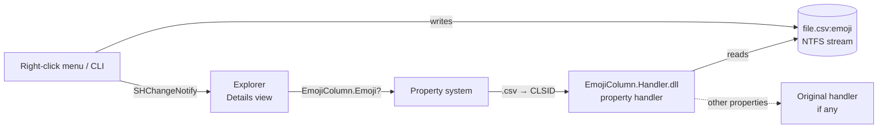

<p align="center">
  
</p>

<h1 align="center">Emoji Column</h1>

<p align="center">
  <b>A real "Emoji" column for Windows File Explorer.</b><br>
  Tag any file with ✅ ⏳ ⚠️ 💰 🔥 — without renaming it.
</p>

<p align="center">
  <a href="https://github.com/marco3079/emoji-column/actions/workflows/ci.yml"></a>
  <a href="https://github.com/marco3079/emoji-column/releases/latest"></a>
  
  
  <a href="LICENSE"></a>
</p>

<p align="center">
  <a href="README.pt-BR.md">🇧🇷 Leia em português</a>
</p>

---

```
 Name                               Date modified        Type        Size     Emoji
 ─────────────────────────────────────────────────────────────────────────────────
 bank-statement-2026-10.csv         11/13/2026 4:00 PM   CSV file    436 B     ✅
 invoice-2026-11.csv                11/13/2026 4:00 PM   CSV file    1.93 KB   💰
 card-statement-2026-10.csv         11/13/2026 3:59 PM   CSV file    6.70 KB   ⏳
 card-bill-2026-11.csv              11/13/2026 3:59 PM   CSV file    1.91 KB   ⚠️
 card-bill-2026-12.csv              11/13/2026 3:59 PM   CSV file    1.63 KB   🔥
```

## Why

Windows lets you sort and group files by dozens of columns, but there is no quick way to *mark* a file —
"already paid", "needs review", "important". Renaming files breaks links and scripts; color labels
don't exist. **Emoji Column** adds a native Explorer column that you can sort, group and filter by,
backed by a tiny tag stored inside the file's own NTFS metadata.

## Features

- 🧩 **Native column** — appears in *Details* view next to Name, Date, Size. Sort, group (*Group by → Emoji*) and stack by it.
- 🖱️ **Right-click to tag** — *Emoji* submenu with quick emojis, a picker with 48 emojis + any custom one (<kbd>Win</kbd> + <kbd>.</kbd>), and *Remove emoji*.
- 📚 **Multi-select** — tag a whole selection at once; one picker window for all files.
- 🕒 **Doesn't touch your files** — the name, the content **and the "Date modified"** stay exactly the same.
- 🔗 **Plays nice with other handlers** — if a file type already has a property handler (Office, images…), it is chained, not replaced, and restored on uninstall.
- ⌨️ **Command line** — `EmojiColumn.exe set ✅ file.csv` for scripts and automation.
- 🌎 **English and Portuguese** UI, picked automatically from the Windows language.
- 🪶 **Tiny** — ~80 KB, no runtime to install (uses .NET Framework 4.8, built into Windows 10/11).

## Install

1. Download `EmojiColumn-x.y.z.zip` from the [latest release](https://github.com/marco3079/emoji-column/releases/latest) and extract it anywhere.
2. Run `EmojiColumn.exe`, review the file types and click **Install / Update** (asks for administrator rights).
3. Accept the prompt to restart Explorer.
4. In a folder, right-click a column header → **More…** → tick **Emoji**.

> [!TIP]
> To use the same columns in every folder of the same kind, open *View → Options → View* and click **Apply to Folders**.

The app copies itself to `C:\Program Files\EmojiColumn` and appears in *Settings → Apps* for a clean uninstall.

## Usage

**Explorer:** select one or more files → right-click → **Show more options** → **Emoji** → pick one.

**Command line:**

```powershell
EmojiColumn.exe set ✅ .\invoice-2026-11.csv .\card-bill-2026-11.csv
EmojiColumn.exe get *.csv          # prints "✅  path" for each file (wildcards supported)
EmojiColumn.exe clear .\invoice-2026-11.csv
EmojiColumn.exe pick .\report.pdf  # opens the picker
EmojiColumn.exe install --ext .csv,.pdf,.xlsx --quiet
EmojiColumn.exe uninstall --quiet
```

**PowerShell, no app needed** — the tag is a plain UTF-8 alternate data stream named `emoji`:

```powershell
Get-Content .\file.csv -Stream emoji
Set-Content .\file.csv -Stream emoji -Value '✅' -Encoding UTF8
```

## How it works



- `schema/EmojiColumn.propdesc` registers a new Shell property, **`EmojiColumn.Emoji`**, so it shows up in the *Choose Details* list.
- `EmojiColumn.Handler.dll` is a COM [property handler](https://learn.microsoft.com/windows/win32/properties/property-handlers) registered for the chosen extensions. It reads the `:emoji` stream and passes every other property through to the handler that was there before.
- `EmojiColumn.exe` is the manager, picker and CLI. It writes the stream, restores the file's timestamps and tells Explorer to refresh.

More details in [docs/ARCHITECTURE.md](docs/ARCHITECTURE.md).

## Limitations

- **NTFS only.** Alternate data streams are lost when a file goes to FAT/exFAT drives, e-mail, ZIP files or most cloud services (OneDrive keeps the local copy tagged, but the tag doesn't sync).
- **Per file type.** Windows binds property handlers to extensions, so the column works for the types you enable (19 common ones by default). Folders can't be tagged.
- On Windows 11 the entry is in the classic menu (**Show more options** or <kbd>Shift</kbd> + right-click).
- Windows Search doesn't index the emoji (sorting/grouping in Explorer works; searching `emoji:✅` may not).

## Build from source

No Visual Studio or SDK needed — the C# compiler ships with Windows:

```powershell
git clone https://github.com/marco3079/emoji-column.git
cd emoji-column
.\build.ps1 -Zip      # output in .\dist
```

## Uninstall

*Settings → Apps → Emoji Column → Uninstall*, or `EmojiColumn.exe uninstall`. Tags stay in your files (harmless, invisible)
and come back if you reinstall.

## Contributing

Issues and pull requests are welcome — see [CONTRIBUTING.md](CONTRIBUTING.md). For security issues, see [SECURITY.md](SECURITY.md).

## License

[MIT](LICENSE) © 2026 marco3079
