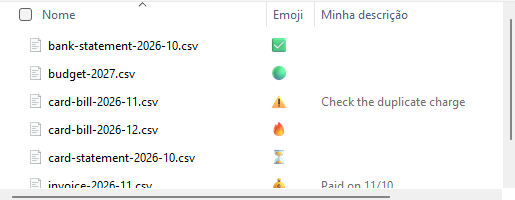
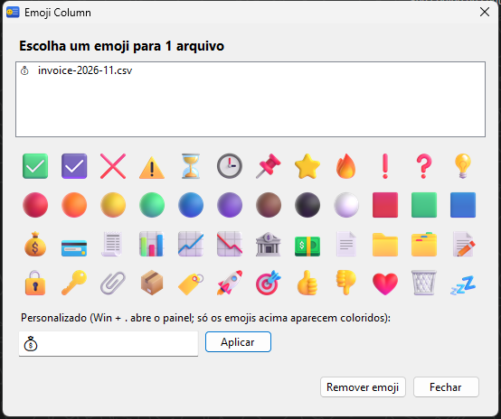

<p align="center">
  
</p>

<h1 align="center">Emoji Column</h1>

<p align="center">
  <b>Uma coluna "Emoji" de verdade no Explorador de Arquivos do Windows.</b><br>
  Marque qualquer arquivo com ✅ ⏳ ⚠️ 💰 🔥 — sem renomear.
</p>

<p align="center">
  <a href="https://github.com/marco3079/emoji-column/actions/workflows/ci.yml"></a>
  <a href="https://github.com/marco3079/emoji-column/releases/latest"></a>
  
  <a href="LICENSE"></a>
</p>

<p align="center">
  <a href="README.md">🇺🇸 Read in English</a>
</p>

---

<p align="center">
  
  &nbsp;
  
</p>

## Por quê

O Windows deixa ordenar e agrupar arquivos por dezenas de colunas, mas não tem um jeito rápido de *marcar*
um arquivo — "já paguei", "revisar", "importante". Renomear quebra atalhos e scripts. O **Emoji Column**
adiciona uma coluna nativa do Explorer, que dá para ordenar, agrupar e filtrar, guardando a marca
nos metadados NTFS do próprio arquivo.

## Recursos

- 🎨 **Emojis coloridos no Explorer** — 48 emojis aparecem como ícones coloridos (Fluent Emoji 3D) direto no modo *Detalhes*.
- 🧩 **Colunas nativas** — *Emoji* (colorida), *Emoji (texto)* (para ordenar e agrupar, aceita qualquer emoji) e *Minha descrição*.
- 📝 **Coluna "Minha descrição"** — texto livre por arquivo, editado pelo botão direito, no painel de detalhes (<kbd>Alt</kbd> + <kbd>Shift</kbd> + <kbd>P</kbd>) ou em *Propriedades → Detalhes*.
- 🖱️ **Botão direito para marcar** — submenu *Emoji* com emojis rápidos, seletor com 48 emojis + qualquer um personalizado (<kbd>Win</kbd> + <kbd>.</kbd>) e *Remover emoji*.
- 📚 **Vários arquivos de uma vez** — uma única janela para toda a seleção.
- 🕒 **Não mexe nos seus arquivos** — nome, conteúdo **e "Data de modificação"** continuam iguais.
- 🔗 **Convive com outros handlers** — se o tipo de arquivo já tinha um handler de propriedades (Office, imagens…), ele é encadeado, não substituído, e restaurado ao desinstalar.
- ⌨️ **Linha de comando** — `EmojiColumn.exe set ✅ arquivo.csv` para scripts.
- 🌎 Interface em **português e inglês**, conforme o idioma do Windows.
- 🪶 **Leve** — ~80 KB, sem runtime para instalar (usa o .NET Framework 4.8 que já vem no Windows 10/11).

## Instalação

1. Baixe o `EmojiColumn-x.y.z.zip` da [última versão](https://github.com/marco3079/emoji-column/releases/latest) e extraia.
2. Abra o `EmojiColumn.exe`, confira os tipos de arquivo e clique em **Instalar / Atualizar** (pede permissão de administrador).
3. Aceite reiniciar o Explorer.
4. Numa pasta, clique com o botão direito no cabeçalho de uma coluna → **Mais…** → marque **Emoji** e **Minha descrição** (e **Emoji (texto)** se quiser ordenar ou agrupar por emoji).

> [!TIP]
> Para usar as mesmas colunas em todas as pastas do mesmo tipo: *Exibir → Opções → Modo de Exibição* → **Aplicar às Pastas**.

## Uso

**No Explorer:** selecione os arquivos → botão direito → **Mostrar mais opções** → **Emoji** → escolha um emoji, ou **Descrição…** para escrever uma descrição.
Também dá para clicar no campo *Minha descrição* do painel de detalhes (<kbd>Alt</kbd> + <kbd>Shift</kbd> + <kbd>P</kbd>) e digitar.

**Linha de comando:**

```powershell
EmojiColumn.exe set ✅ .\fatura-2026-11.csv .\cartao-2026-11.csv
EmojiColumn.exe get *.csv
EmojiColumn.exe clear .\fatura-2026-11.csv
EmojiColumn.exe set-desc "Paga em 10/11" .\fatura-2026-11.csv
EmojiColumn.exe install --ext .csv,.pdf,.xlsx --quiet
EmojiColumn.exe uninstall --quiet
```

## Limitações

- **Só NTFS.** A marca se perde ao copiar para pendrive FAT/exFAT, e-mail, ZIP ou nuvem (no OneDrive a cópia local continua marcada, mas a marca não sincroniza).
- **48 emojis coloridos.** O Explorer só desenha ícones declarados com antecedência, então a coluna colorida cobre os 48 emojis do seletor. Qualquer outro emoji (do <kbd>Win</kbd> + <kbd>.</kbd>) é salvo e aparece em *Emoji (texto)*.
- **Por tipo de arquivo.** O Windows liga handlers de propriedade a extensões; a coluna funciona nos tipos ativados (19 comuns por padrão). Pastas não podem ser marcadas.
- No Windows 11 o item fica no menu clássico (**Mostrar mais opções** ou <kbd>Shift</kbd> + botão direito).

## Compilar

Não precisa de Visual Studio — o compilador C# já vem com o Windows:

```powershell
git clone https://github.com/marco3079/emoji-column.git
cd emoji-column
.\build.ps1 -Zip
```

## Desinstalar

*Configurações → Aplicativos → Emoji Column → Desinstalar*, ou `EmojiColumn.exe uninstall`.

## Licença

[MIT](LICENSE) © 2026 marco3079. Arte dos emojis: [Fluent Emoji](https://github.com/microsoft/fluentui-emoji) © Microsoft, MIT — veja [THIRD-PARTY-NOTICES.md](THIRD-PARTY-NOTICES.md).
